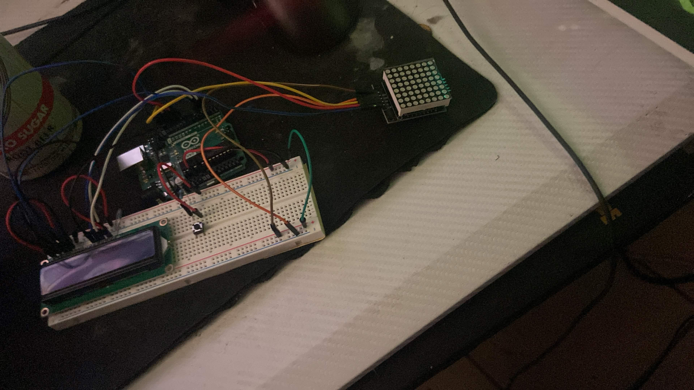
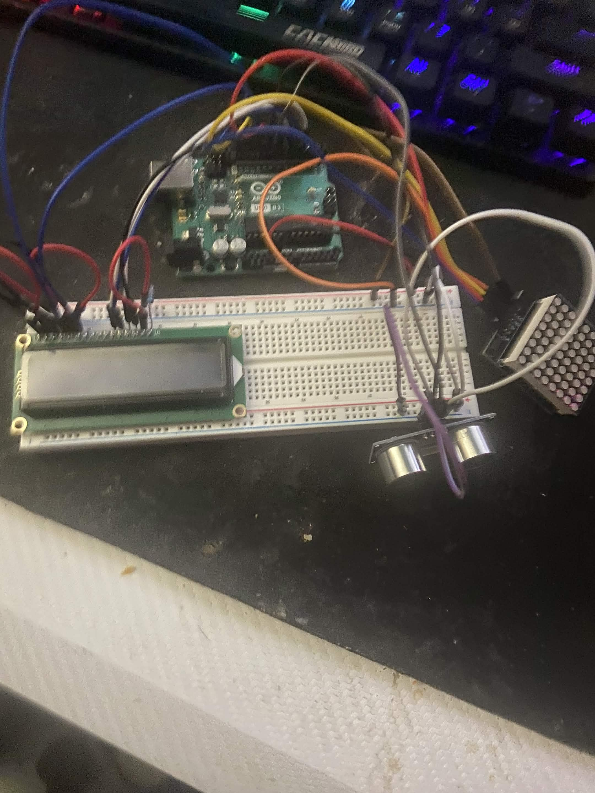
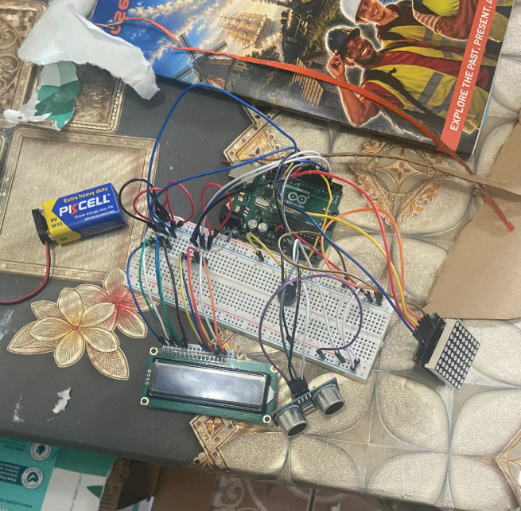

#  Anniversary Gift Prototype ❤️

## Project Overview

This project is an anniversary gift built using Arduino and electronic components. The goal is to create a meaningful and interactive experience that automatically reacts when a user's hand approaches the device.

The project combines displays, sensors, LEDs, a buzzer, and embedded programming to create a personalized electronic gift.

## Goal

Create a compact interactive gift that displays personalized messages, visual effects, and music when a hand is detected near the device.

The project combines:

* Embedded Programming
* Electronics
* Sensor Integration
* Display Systems
* Audio Output
* Engineering Design

---

## Current Features

### Inputs

* HC-SR04 Ultrasonic Sensor

### Outputs

* 16x2 LCD Display
* MAX7219 8x8 LED Matrix
* LEDs
* Buzzer

### Behavior

When a hand is detected within 5 cm:

* LCD displays anniversary messages
* LED matrix displays a heart pattern
* LEDs turn on
* Buzzer plays a song from The Legend of Zelda: Ocarina of Time

When no object is detected:

* Displays remain inactive
* LEDs remain off
* Buzzer stays silent

---

## Project Evolution

### Version 1 - LCD Message System

The original design used a push button to cycle through messages displayed on the LCD.

**Features**

* LCD Display
* Push Button Input
* Message Cycling System

**Challenge**
I initially struggled to make a single button perform different actions for each press because I only knew how to use buttons as simple ON/OFF inputs.

**What I Learned**

* State variables
* Button input logic
* Counter-based programming

**Prototype**

---

### Version 2 - LED Matrix Integration

An 8x8 MAX7219 LED Matrix was added to display a heart pattern.

**Features Added**

* LED Matrix Display
* Heart Pattern Output

**Challenge**
The button-based interaction became impractical because the final enclosure would make the button difficult to access.

**Design Decision**
The button system would eventually be replaced.

**Prototype**

---

### Version 3 - Matrix Debugging

Multiple attempts were required before the LED matrix worked correctly.

**Challenges**

* Understanding matrix libraries
* Display configuration
* Software debugging

**Result**
Successfully displayed a heart pattern on the matrix.

**What I Learned**

* Library usage
* Debugging techniques
* Breaking large problems into smaller steps

### Version 4 - Ultrasonic Sensor System

The push button was replaced with an HC-SR04 ultrasonic sensor.

**Features Added**

* Distance Detection
* Automatic Activation
* LCD + Matrix + LED Integration

**Behavior**
When a hand is detected within 5 cm:

* LCD activates
* Matrix displays a heart
* LED turn on

**Why This Change Was Made**
The project became easier and more natural to use because the user no longer needed to find and press a hidden button.

**Prototype**

---

### Version 5 - Buzzer and Music (Current Version)

A buzzer was added so the heart enclosure plays a song from The Legend of Zelda: Ocarina of Time whenever a hand comes within 5 cm.

**Features Added**

* Buzzer Audio Output
* Melody playback triggered by the ultrasonic sensor
* Synchronized sound, display, and lights

**Why This Change Was Made**
The song has deep personal meaning to me from childhood, so adding it made the gift feel far more personal and emotional than the visuals alone.

**Note on the Code**
Because of limited time, I used existing melody code from a GitHub repository for the song playback rather than transcribing the notes myself, then integrated it with my own sensor, LCD, matrix, and LED logic.

**What I Learned**

* Driving a buzzer with tone-based output
* Reading and adapting open-source code
* Integrating third-party code into an existing project
* Managing time and scope on a deadline

**Final Product**

---

## Components

* Arduino Uno
* HC-SR04 Ultrasonic Sensor
* 16x2 LCD Display
* MAX7219 8x8 LED Matrix
* LEDs
* Buzzer
* Breadboard
* Jumper Wires
* Resistors

---

## How It Works

1. The HC-SR04 continuously measures distance.
2. Arduino processes the sensor reading.
3. If distance ≤ 5 cm:

   * LCD messages are displayed.
   * LED matrix displays a heart.
   * LEDs activate.
   * Buzzer plays the song.
4. If distance > 5 cm:

   * Outputs remain inactive.

## Final Build
The image below shows the final version

---

## Challenges

### LCD Integration

Learning how LCD displays communicate with Arduino and how to properly control text output.

### Button Logic

Creating a system where one button performed different actions based on the number of presses.

### Matrix Programming

The matrix required several failed software attempts before functioning correctly.

### Design Changes

The original design relied on a push button, but enclosure constraints led to a redesign using an ultrasonic sensor.

### Combining Audio with Other Outputs

Adding the buzzer meant fitting song playback into code that was already managing the sensor, LCD, matrix, and LEDs.

---

## What I Learned

* LCD Programming
* Sensor Integration
* State-Based Programming
* Embedded Systems Logic
* Audio Output with a Buzzer
* Adapting Open-Source Code
* Hardware Debugging
* Software Debugging
* Engineering Design Iteration

---

## Credits

* Song playback code adapted from a GitHub repository: [add repo name and link here]
* Melody from *The Legend of Zelda: Ocarina of Time* (Nintendo)

---

## Future Improvements
* Improved enclosure design
* Additional sensor interactions
* Writing my own melody code from scratch

---

## Final Notes

This project demonstrates the development of an interactive embedded system through multiple design iterations. The final design focuses on creating a simple user experience by using sensor-based interaction rather than manual controls, and adds a personal touch through music that carries real meaning for me.
